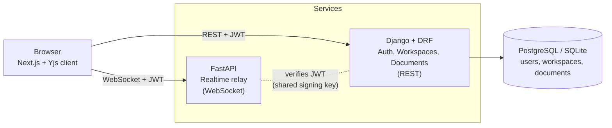

# Confluo

**Real-time collaborative document editor built on a microservices architecture.**

Confluo lets teams create workspaces, invite members with role-based access, and edit documents together in real time. Edits from every collaborator merge conflict-free using CRDTs (Yjs), and a dedicated realtime service scales independently from the main application API.

> **Status:** Core flow is working end to end (auth → workspaces → documents → live multi-user sync). See the [Roadmap](#roadmap) for what is built and what is coming next.

<!-- Replace with your recording once ready -->
<!--  -->

---

## Why this project

Most CRUD apps never face the hard parts of distributed systems. Confluo was built to work through them directly:

- How do you authenticate a **WebSocket** connection when browsers cannot set custom headers?
- How do you let many people edit the same document at once **without conflicts**?
- How do you split a system into services that **scale on different axes** (request volume vs. concurrent connections)?
- How do you share authentication across services without sharing a database?

---

## Features

### Implemented

- **Authentication** with JWT access and refresh tokens, plus automatic token refresh on the client
- **Workspaces** with membership and roles (owner, editor, viewer)
- **Invite members** to a workspace by email with a chosen role
- **Documents** with full CRUD, scoped to workspaces, with permission checks on read and write
- **Authorization on create:** users can only create documents in workspaces they belong to
- **Real-time collaborative editing:** multiple users edit the same document simultaneously, merged conflict-free with Yjs (CRDT)
- **Presence:** live count of people viewing a document
- **Cross-service auth:** JWTs issued by the Django service are verified by the FastAPI realtime service during the WebSocket handshake
- **Next.js frontend** with login/register, workspace dashboard, document list and live editor

### Planned

See the [Roadmap](#roadmap).

---

## Architecture



**Two services, two scaling profiles:**

| Service | Responsibility | Why it is separate |
|---|---|---|
| **Django (REST)** | Users, auth, workspaces, memberships, document metadata, permissions | Relational, CRUD-heavy, benefits from Django's ORM and admin |
| **FastAPI (WebSocket)** | Holds long-lived connections and relays Yjs updates between clients in a document "room" | Async I/O, scales on concurrent connections rather than request rate |

### How real-time sync works

1. The client opens `ws://<host>/ws/<document_id>?token=<JWT>`.
2. FastAPI verifies the JWT (issued by Django) before accepting the socket.
3. Accepted sockets join an in-memory room keyed by `document_id`.
4. Yjs on each client produces small binary updates; the server relays them to every other client in the room.
5. Yjs merges updates deterministically on every client, so everyone converges to the same document, even with concurrent edits.

The relay never interprets document content; it only forwards bytes. Conflict resolution lives in the CRDT.

---

## Tech stack

| Layer | Technology |
|---|---|
| Frontend | Next.js (App Router), React, TypeScript, Axios |
| Realtime sync | Yjs, y-websocket |
| Application API | Python, Django, Django REST Framework, SimpleJWT |
| Realtime service | Python, FastAPI, WebSockets, python-jose |
| Database | SQLite in development, PostgreSQL planned |
| Auth | JWT (access + refresh), shared signing key between services |

---

## Project structure

```
confluo/
├── backend-django/        # Auth, workspaces, documents (REST API)
│   ├── config/            # Django settings and root URLs
│   ├── users/             # Custom user model, register/login/me
│   ├── workspaces/        # Workspace, Membership, role permissions
│   └── documents/         # Document, DocumentSnapshot
├── backend-fastapi/       # Realtime collaboration service
│   ├── main.py            # App entrypoint
│   └── app/
│       ├── auth.py                # JWT verification
│       ├── connection_manager.py  # Per-document rooms
│       └── ws_routes.py           # /ws/{document_id}
├── frontend/              # Next.js application
│   ├── app/               # Routes: auth, dashboard, doc editor
│   ├── components/        # Editor, PresenceBar
│   └── lib/               # API client, auth helpers, Yjs provider
└── README.md
```

---

## Getting started

### Prerequisites

- Python 3.11+
- Node.js 18+

### 1. Django service (port 8000)

```bash
cd backend-django
python -m venv venv
venv\Scripts\activate          # macOS/Linux: source venv/bin/activate
pip install django djangorestframework djangorestframework-simplejwt django-cors-headers
python manage.py migrate
python manage.py createsuperuser
python manage.py runserver
```

### 2. FastAPI realtime service (port 8001)

```bash
cd backend-fastapi
python -m venv venv
venv\Scripts\activate
pip install fastapi "uvicorn[standard]" "python-jose[cryptography]" python-dotenv
```

Create `backend-fastapi/.env`:

```dotenv
JWT_SECRET='<exactly the same value as Django SECRET_KEY>'
JWT_ALGORITHM=HS256
```

Run it:

```bash
uvicorn main:app --reload --port 8001
```

> The signing key must match Django's `SECRET_KEY`, otherwise every WebSocket connection is rejected.

### 3. Frontend (port 3000)

```bash
cd frontend
npm install
```

Create `frontend/.env.local`:

```dotenv
NEXT_PUBLIC_DJANGO_API_URL=http://localhost:8000/api
NEXT_PUBLIC_FASTAPI_WS_URL=ws://localhost:8001/ws
```

```bash
npm run dev
```

### 4. Try it

1. Register and log in at `http://localhost:3000`.
2. Create a workspace, then create a document.
3. Open the same `/doc/<id>` URL in a second tab (or another browser) and type in one. The other updates live.

---

## API overview

### REST (Django)

| Method | Endpoint | Description |
|---|---|---|
| POST | `/api/auth/register/` | Create an account |
| POST | `/api/auth/login/` | Obtain access and refresh tokens |
| POST | `/api/auth/refresh/` | Refresh an access token |
| GET | `/api/auth/me/` | Current user profile |
| GET, POST | `/api/workspaces/` | List your workspaces / create one (you become owner) |
| GET | `/api/workspaces/{id}/` | Workspace detail with members |
| POST | `/api/workspaces/{id}/invite/` | Invite a member with a role (owner/editor only) |
| GET, POST | `/api/documents/?workspace={id}` | List documents / create one in a workspace you belong to |
| GET, PATCH, DELETE | `/api/documents/{id}/` | Read, rename or delete (write requires editor/owner) |

### WebSocket (FastAPI)

```
ws://localhost:8001/ws/{document_id}?token=<access_token>
```

Binary Yjs frames only. Connections with a missing or invalid token are closed with a policy-violation code.

---

## Design decisions

- **Token in the WebSocket query string.** The browser `WebSocket` API cannot set custom headers during the handshake, so the JWT is passed as a query parameter and verified before the socket is accepted.
- **Yjs for sync instead of hand-rolled OT.** Conflict resolution is a hard, well-solved problem. Using a mature CRDT library lets the engineering effort go into the surrounding system: auth, service boundaries and scaling.
- **No shared database between services.** The services only share a signing key for JWT verification, so each can be deployed and scaled independently.
- **Minimal-diff updates.** The editor sends only the changed range to Yjs instead of replacing the whole text, which is what makes simultaneous typing merge correctly.
- **Custom user model from day one.** Set before the first migration, since swapping the user model later is painful.

---

## Known limitations

Being upfront about the current state:

- Document content lives in the Yjs relay's memory only. If every client disconnects, unsaved content is lost until snapshot persistence is added.
- The relay holds rooms in a single process, so it cannot yet scale horizontally.
- The WebSocket service verifies the token but does not yet check that the user is a member of the document's workspace.
- The editor is a plain `<textarea>`; remote cursor positions are approximate.
- Tokens are stored in `localStorage`, and access tokens are reused on WebSocket reconnect, so long sessions need a token refresh before reconnecting.
- Development uses SQLite.

---

## Roadmap

- [x] Custom user model, JWT auth, token refresh
- [x] Workspaces, memberships and role-based permissions
- [x] Document CRUD with permission checks
- [x] FastAPI WebSocket relay with JWT verification
- [x] Real-time sync with Yjs across multiple clients
- [x] Presence count
- [ ] WebSocket authorization against Django (workspace membership check on connect)
- [ ] Persist document state with `DocumentSnapshot`
- [ ] Redis pub/sub so the relay scales across multiple instances
- [ ] Load balancer with sticky sessions for WebSocket traffic
- [ ] DynamoDB for presence and cursor activity
- [ ] GraphQL endpoint for the nested workspace → documents → members dashboard query
- [ ] Switch to PostgreSQL
- [ ] Docker and Docker Compose for all services
- [ ] Kubernetes manifests (deployments, services, ingress, autoscaling)
- [ ] CI/CD with GitHub Actions
- [ ] Rich-text editor binding (Tiptap + Yjs) with shared cursors

---

## Author

**Dhanrajsinh Parmar**
[GitHub](https://github.com/Dhanrajsinh002) · [LinkedIn](https://www.linkedin.com/in/dhanrajsinh-parmar-658160176)